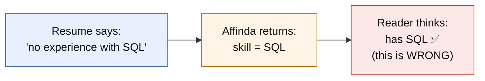
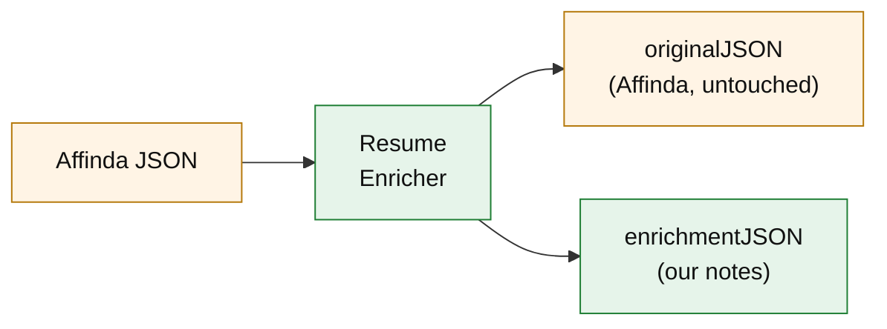
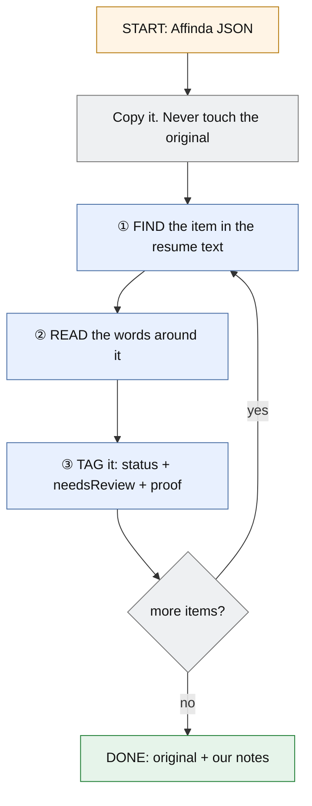
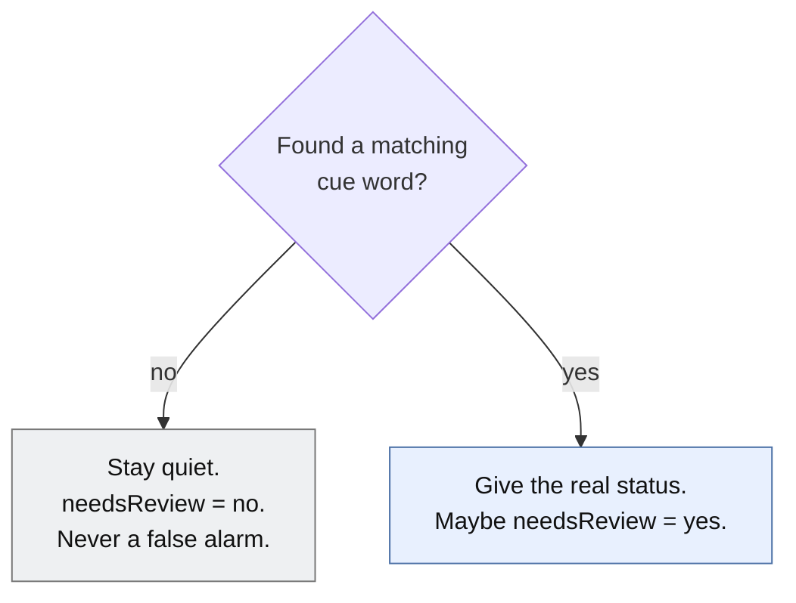
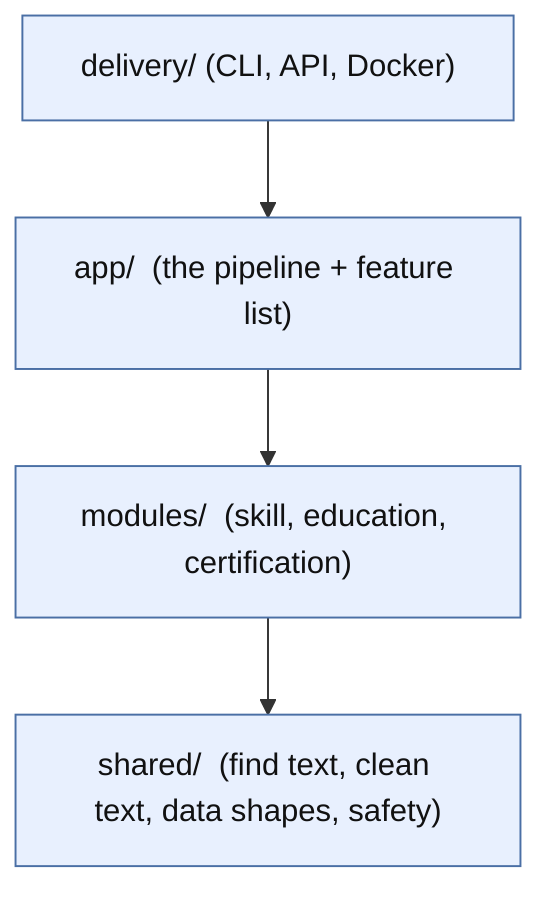

# Affinda Resume Enricher

**Affinda reads a resume and misses the small print. We add it back.**

That is the whole product in one line. We never change Affinda's output. We only add
notes next to it.

> Status: v1, working. 34 tests pass. Tested on 300 real parsed resumes. Has a CLI, a
> web API, and Docker.

---

## 1. The problem (in a picture)

A resume says one thing. Affinda extracts half of it. The reader gets fooled.



Affinda tells you the person *has* SQL. The resume actually said they have **no
experience** with it. The truth was right there in the text. Affinda just dropped it.

This happens with three things:

| The resume really says                      | Affinda gives you  | The wrong conclusion |
| ------------------------------------------- | ------------------ | -------------------- |
| "**no experience** with SQL"          | skill: SQL         | they know SQL        |
| "BSc Computer Science (**withdrew**)" | education: BSc     | they have the degree |
| "AWS cert (**expired** 2021)"         | certification: AWS | the cert is valid    |

We fix exactly this. Nothing more.

---

## 2. What we add (in a picture)

We hand back Affinda's answer **untouched**, plus a second box of our own notes.



Each note is one simple record:

```
skill: SQL
   status      = no_experience     (what the text says)
   needsReview = yes               (worth a look)  ... or "no" = fine
   confidence  = high              (we found it in the text)
   evidence    = "no experience"   (the exact words, and where they are)
```

We write a note for **every** item, good or bad. The customer filters the
`needsReview: yes` ones. It is easier to filter than to recover.

---

## 3. How it works (in a picture)

One function. For every skill, degree, and cert it does three steps:



Every note has **three simple answers**:

```
┌───────────────┬──────────────────────────────┬─────────────────────────┐
│ STATUS        │ what does the text say?      │ comes from the rules    │
│ NEEDS REVIEW  │ should a reader care?        │ fixed table: yes / no   │
│ CONFIDENCE    │ did we find it in the text?  │ high (yes) / low (no)   │
└───────────────┴──────────────────────────────┴─────────────────────────┘
```

**The safety rule:** if we are not sure, we stay quiet.



So a missing rule means we **miss** a problem. It never means we **accuse** a good
person. Missing is cheap. A false accusation is not.

Want the full mechanism, step by step? See [`docs/HOW_IT_WORKS.md`](docs/HOW_IT_WORKS.md).

---

## 4. How it is built (in a picture)

Four layers. Arrows only point down. A layer can use the one below it, never above.



To add a new check in v2: add one folder in `modules/`, add one line in the feature
list. That is it.

---

## 5. Does it work? (the results)

We tested two ways: a **scored** run on 300 résumés we authored (so we know the right
answers), and a **real-world** run on 18 genuine strangers' résumés (no answer key, so we
eyeball it).

**Scored run, 300 authored résumés** (how much dropped small print we got back):

```
SKILL STRENGTH    caught █████████████████████░░░  88%     false alarms: 0
EDUCATION STATUS  caught █████████████████░░░░░░░  76%     false alarms: 0
CERT VALIDITY     caught █████████████████████░░░  88%     false alarms: 0
```

- **Caught** = of the real problems, how many we flagged.
- **False alarms** = good people we wrongly flagged. **Zero, across all 300.**
- Speed: about **1 millisecond per resume** (~1,200 per second on one core).

**Real-world run, 18 genuine résumés** (the honest reality check):

```
DEGREES + CERTS   0 false alarms across 76 items          clean ✅
SKILLS            0 severe false alarms, BUT 23 mild
                  "basic" chirps out of 1,302 skills       needs a glance ⚠️
```

On real résumés the mild **`basic`** tag sometimes lands on the wrong skill (the word
"basic" shows up in comma skill-dumps and course names like "Basic First Aid"). The loud
warnings stayed trustworthy; the quiet "basic" one needs a human glance. We list every
one openly.

Full numbers: scored [`eval/results/REPORT.md`](eval/results/REPORT.md) · real-world
[`eval/results/REAL_REPORT.md`](eval/results/REAL_REPORT.md).

---

## 6. Run it

```bash
pip install -r requirements.txt

python main.py                 # try a built-in sample resume

# command line
python -m resume_enricher.delivery.cli examples/sample_affinda.json --summary

# web API (then open http://127.0.0.1:8000/docs)
uvicorn resume_enricher.delivery.api:app --reload

python -m unittest discover -s tests   # run the 34 tests
python eval/run_eval.py                # rebuild the results
```

In code:

```python
from resume_enricher import enrich
result = enrich(affinda_response)   # -> { "originalJSON": ..., "enrichmentJSON": ... }
```

---

## 7. Where things are

```
resume_enricher/   the engine        (shared, modules, app, delivery)
docs/              4 docs            HOW_IT_WORKS + DECISIONS (choices + roadmap)
                                     + REFERENCE (proof, Affinda bugs, output menu, limits)
                                     + BUGS (Affinda parser bugs + our fixed bugs)
eval/              the test harness  + all 300 resumes + results
tests/             34 tests
examples/          a sample to try
```

Per-file detail lives in the code's own comments, right next to the code.

---

## 8. What is next (v2)

v1 is rules only, on purpose. The resumes it is unsure about are saved as "unknown".
That pile is the exact target for later work:

- a new check for fake employment dates
- a flag for skills the text has but Affinda dropped
- typo-tolerant matching
- an AI step, used **only** on the "unknown" pile

Full plan: the roadmap inside [`docs/DECISIONS.md`](docs/DECISIONS.md).

For the deeper questions (is this already in Affinda? what bugs did we find in it? what
exactly do I get back? where is it weak?) see [`docs/REFERENCE.md`](docs/REFERENCE.md).

Every bug we found, in Affinda's parser and in our own code, is in [`docs/BUGS.md`](docs/BUGS.md).

---

*The full research trail (300-resume experiments, taxonomy, every decision) lives in the
companion **process** repo. This repo is just the finished product.*
