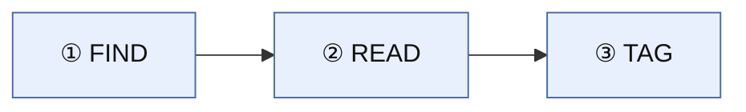
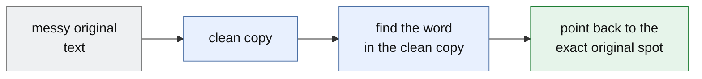
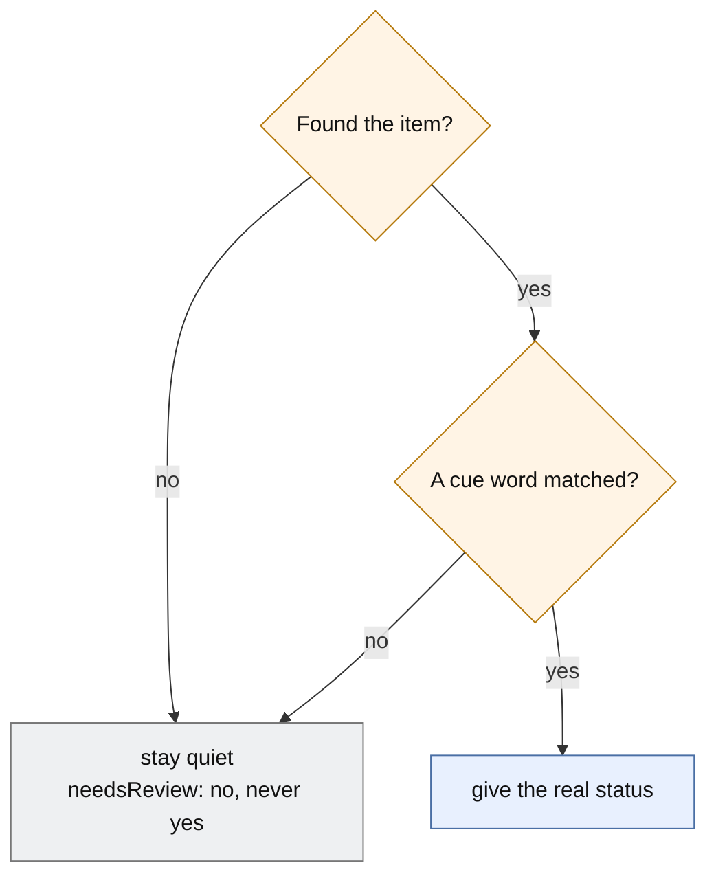

# How it works

The whole product is **one function**.

For every skill, degree, and cert, it does **three steps**:



That is it. The rest of this page is just those three steps, one at a time.

<br/>

---

## ① FIND the item in the resume text

Affinda gives us a clean word like `SQL`.

The resume text is messy: weird spaces, line breaks, `S Q L`.

So we **do not search the messy text directly**. We make a clean copy, search that,
then point back to the exact original spot.



A little **"map"** remembers where each clean letter came from.

That is what keeps the highlight **exactly right**.

> If we cannot find the word, we stop here and stay quiet. No guessing.

<br/>

---

## ② READ the words around it

Now we read the sentence around the item and look for **cue words**.

One sentence can hold many skills at once. So we **cut it into pieces** and read only
the piece that belongs to this skill.

```
"no experience with SQL  ,  expert in Python"
 └──── piece for SQL ────┘   └─ piece for Python ─┘

 SQL    reads only its piece  ->  no_experience
 Python reads only its piece  ->  strong
```

This is why "expert in Python" **never** leaks onto SQL.

<br/>

We check the cue words **worst first, and the first match wins**:

```
   is it "no experience"?   ──► yes ──►  stop. status = no_experience
         else
   is it "learning"?        ──► yes ──►  stop. status = learning
         else
   is it "expert"?          ──► yes ──►  stop. status = strong
         else
   nothing matched          ──────────►  status = plain (stay quiet)
```

So "no experience, but keen to learn" becomes **no_experience**, not "learning".

<br/>

One small but important detail about where a sentence ends:

```
   Skills:   "Git — Linux — Agile"      the dash SPLITS skills apart
   Certs:    "CISSP — expired 2022"     the dash JOINS the cert to its status
```

So skills treat a dash as a wall. Degrees and certs do not.

> This one fix raised degree and cert results from about 30% up to 76 to 88%.

<br/>

---

## ③ TAG it

Every item gets **three simple answers**:

```
┌────────────┬───────────────────────────────┬──────────────────────────┐
│ STATUS     │  what does the text say?      │  from the cue rules       │
├────────────┼───────────────────────────────┼──────────────────────────┤
│ SEVERITY   │  should a reader care?        │  a fixed table lookup     │
│            │                               │  needsReview: yes or no   │
├────────────┼───────────────────────────────┼──────────────────────────┤
│ CONFIDENCE │  did we find it in the text?  │  high (yes) / low (no)    │
└────────────┴───────────────────────────────┴──────────────────────────┘
```

**Status** is read from the text.

**Severity** is never decided freshly. It is a fixed lookup:

```
   yes  =  no_experience, learning, incomplete, expired, revoked ...
   no   =  strong, completed, active, plain, unknown ...
```

**Confidence** just says whether we found the item at all.

<br/>

We also keep the **proof**: the exact words we matched, and where they sit.

The highlight and the quote always point at the **same thing**.

<br/>

---

## The safety net

If we are ever unsure, we **stay quiet**. We never guess.



A missing rule means we **miss** a problem.

It never means we **accuse** a good person.

<br/>

---

## The two promises

```
  ①  We never change Affinda's data.
      We copy it, work on the copy, and check at the end that the original is untouched.

  ②  When unsure, we stay silent.
      No crash on missing text. No guess. Just needsReview "no".
```

<br/>

---

## One full example

Resume text:

```
Skills: no experience with SQL, expert in Python, learning Excel.
```

Watch `SQL` go through the three steps:

```
① FIND
     found "SQL" in the text at characters 27 to 30
     sentence picked up around it

② READ
     cut the sentence into pieces at the commas
     keep SQL's piece:  "no experience with SQL"
     worst-first cues:  "no experience" matches

③ TAG
     status     = no_experience
     needsReview = yes            (fixed lookup)
     confidence = high           (we found it)
     evidence   = "no experience" at characters 8 to 21
```

Final note:

```
SQL   ->   no_experience | yes | high | proof: "no experience"
```

And because Python sat in a **different piece**, it scored **strong**, all on its own.
